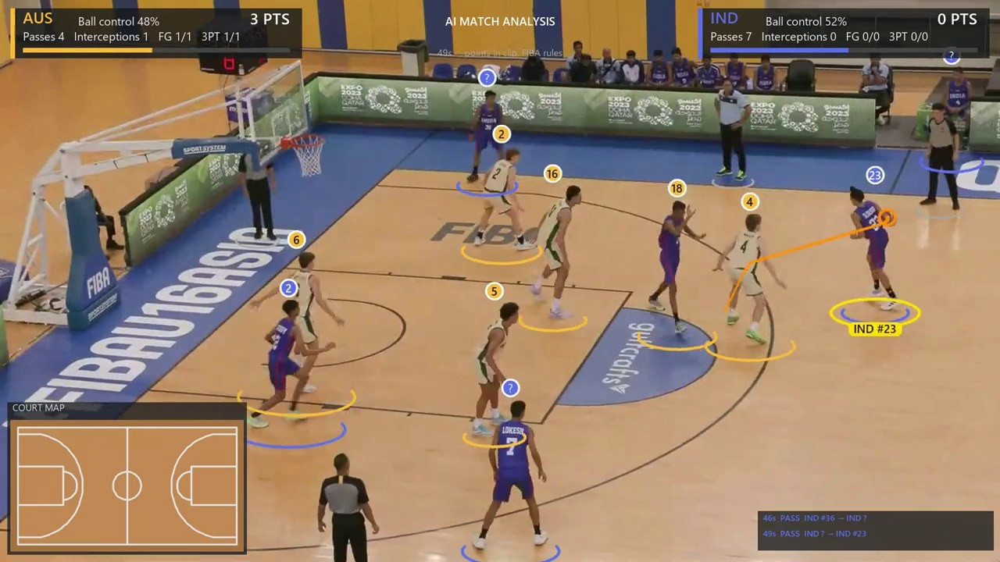
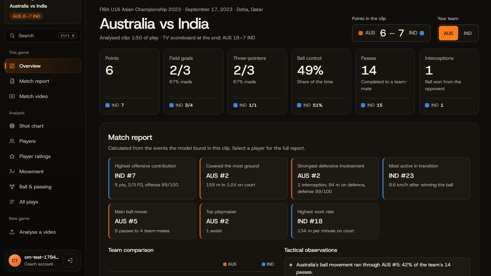

# ClutchMetrics — AI match analysis from any basketball video

Upload a basketball game video. ClutchMetrics finds every player, reads their jersey numbers, follows the ball, maps
everyone onto a real court in metres and detects passes, interceptions and shots with FIBA scoring rules. The result is
a coach dashboard, a personal report for every player and a broadcast-style analysis video. No sensors, no wearables:
just the video.

**Live demo (no login):** https://praveenregar30.github.io/ClutchMetrics-2/coach-dashboard.html?demo=1 · **Models:** see [Model weights](#model-weights)



*Real output of the pipeline (FIBA U16 Asian Championship footage, shown for research/demo purposes only).*

---

## Results (measured, not estimated)

| What | Result | How it was measured |
|---|---|---|
| **Points vs official scoreboard** | **12 / 12 baskets found, every 2/3-point value correct** (Qatar +21, India +9 = TV score change 49–43 → 70–52) | 3 minutes of a game the models had never seen, checked against the broadcast scoreboard |
| **Jersey numbers correct** | **90 %** (up from 87 %) | 150 player boxes labelled by hand |
| **Visible numbers identified** | **92 %** | same test |
| **Frames mapped to the court** | **94 %** | 27 calibrated keyframes + camera-motion tracking |
| **Ball detection (AP50) on new FIBA video** | **0.30 → 0.69** after our fine-tuning | held-out frames, later part of the clip |
| **Player / referee detection (AP50)** | **0.98 / 0.93** | hand-labelled frames |
| **Speed** | ~10 GPU-minutes per minute of video (3-min clip ≈ 30 min on an NVIDIA L4) | cloud runs |

## How it works

| Step | What happens | Technology |
|---|---|---|
| 1. Detect | Players, referees and the ball in every analysed frame (15 fps) | **RF-DETR Nano**, fine-tuned by us on NBA + college + our own FIBA frames |
| 2. Track | Each player keeps an identity across frames; camera pans are compensated | IoU matching + Hungarian algorithm, Lucas–Kanade optical flow + RANSAC |
| 3. Teams | Shirt colours split the two teams; referees separated by the detector | CIE-LAB colour + k-means (k = 2) |
| 4. Jersey numbers | Number patches found, enlarged and read; a number is accepted only when several frames agree | second RF-DETR (numbers, rims) + **Qwen3-VL-2B** vision-language model + voting |
| 5. Court | Pixels → metres, giving positions, distance and speed | homography (DLT) from points clicked in a mapping window, carried by camera motion |
| 6. Events | Possession, passes, interceptions, shots; 2 or 3 points from the shooter's position; checked against the TV scoreboard (read by Qwen3-VL) | rules (FIBA court geometry) |
| 7. Output | Annotated analysis video + `match.json` for the dashboards | OpenCV, ffmpeg |



## Features

- **Upload any video** (MP4, MOV, AVI, MKV, WebM…, any length) from the browser; large files go up in 8 MB pieces.
- **Court-mapping window** in the browser: click a few court points on chosen pictures; lines are predicted for the next ones.
- **Coach dashboard:** team stats, match report, analysis video with a clickable timeline, shot chart by zone, players
  table, Player Performance Index (0–100) with strengths/weaknesses, movement and heat maps, passing network, all plays.
- **Player report:** "which player are you?", your rating, you vs your team, highlights reel, progress across games.
- **Accounts:** Firebase sign-in with coach/player roles; the server verifies the login token on every request and
  every user sees only their own analyses. Cancel and permanent delete included.

## Repository layout

```
model/            AI pipeline + analysis server (Python)
  basketball_pipeline.py   detect -> track -> ball
  jersey_numbers.py        number boxes + Qwen3-VL reading + voting
  court_mapping.py         keyframe calibration + homography -> positions, speed
  match_events.py          possession, passes, interceptions, shots, scoreboard check
  render_broadcast.py      analysis video with overlays
  export_dashboard.py      match.json + browser video for the dashboards
  server.py                FastAPI analysis server (jobs, uploads, auth, court mapping, cancel, delete)
  train_rfdetr.py (+ notebook)   detector fine-tuning
  label_numbers.py         hand-labelling tool + jersey accuracy score
  cloud/                   scripts for running the server on a cloud GPU (Jarvislabs)
  README_model_details.md  every script, every command, all experiment results
website/          static website (HTML/CSS/vanilla JS, no framework) — the dashboards
docs/             pitch deck and the full technical guide (architecture, maths, decisions, 70 viva Q&As)
```

## Run it

```bash
# Python 3.11 + an NVIDIA GPU (8 GB is enough). Install PyTorch with CUDA first, then:
pip install -r requirements.txt
cd model
# put the model weights in model/weights/ (see below), then analyse a clip:
python basketball_pipeline.py detect --video game.mp4 --name mygame --start 0 --end 120 --fps 15
python basketball_pipeline.py track  --video game.mp4 --name mygame
python basketball_pipeline.py ball   --video game.mp4 --name mygame
python jersey_numbers.py --name mygame --teams HOME AWAY
python court_mapping.py calibrate --name mygame     # click court points on a few pictures
python court_mapping.py apply --name mygame
python match_events.py --name mygame --teams HOME AWAY
python render_broadcast.py --name mygame
```

Or run the full web flow: `python server.py` (analysis server on `localhost:8000`) and open the website with
`localStorage.setItem('cm-server', 'http://localhost:8000')` in the browser console.
Full details: [model/README_model_details.md](model/README_model_details.md).

## Model weights

The trained weights are larger than GitHub's file limit and are published on Hugging Face:
**https://huggingface.co/raghav1210gupta/clutchmetrics-models**

| File | Put it in | What it is |
|---|---|---|
| `rfdetr_basketball_v2/best/` | `model/weights/rfdetr_basketball_v2/best/` | players / ball / referees detector (fine-tuned by us) |
| `rfdetr_5class/checkpoint_best_total.pth` | `model/weights/rfdetr_5class/` | jersey-number patches and rims |

Qwen3-VL-2B-Instruct downloads automatically from Hugging Face on first use.

## What we learned (including what did not work)

- A **bigger reader (Qwen3-VL-8B) was not better** than 2B (88 % vs 90 %) and 3× slower; enlarging the number crops helped more.
- **Our own trained number reader** (ResNet-18, 20,500 crops incl. the public E-BARD dataset) reached 36 % on an unseen game vs 77 % for Qwen3-VL — so we kept the vision-language model.
- An **automatic court-landmark model** (YOLO11-pose, 1,787 frames from 3 arenas) failed on an unseen arena (13–16 m error), so court mapping stays a quick manual step.
- Honest limits: tracking can swap players who cross closely; rebounds and fouls are not detected yet; highlight reels with constant camera cuts are hard to map.

## Team

Design Practicum, IIT Mandi (B.Tech, 2nd year):
Raghav Gupta · Abhishek Gupta · Harsh Bhadana · Suyash Tiwari · Raja — Faculty guide: Dr. Satvasheel Powar

## Credits and licences

- [RF-DETR](https://github.com/roboflow/rf-detr) (Roboflow, Apache-2.0); starting checkpoint and training datasets by
  [koppolusameer on Hugging Face](https://huggingface.co/koppolusameer) (see their pages for terms).
- [Qwen3-VL-2B-Instruct](https://huggingface.co/Qwen/Qwen3-VL-2B-Instruct) (Alibaba Qwen team).
- [E-BARD Jersey Number Recognition dataset](https://huggingface.co/datasets/GabrieleGiudici/E-BARD-JerseyNumberRecognition) (CC-BY-4.0), used in experiments.
- Game footage belongs to its broadcasters/federations and is **not** included in this repository.

Our own code is released under the MIT licence (see [LICENSE](LICENSE)).
